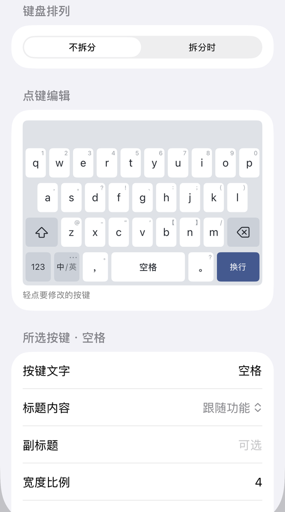
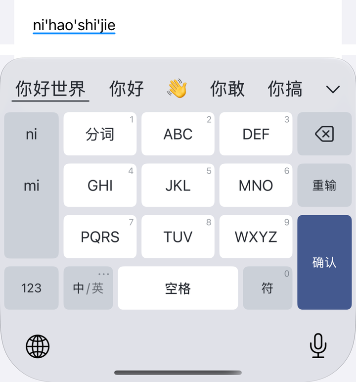
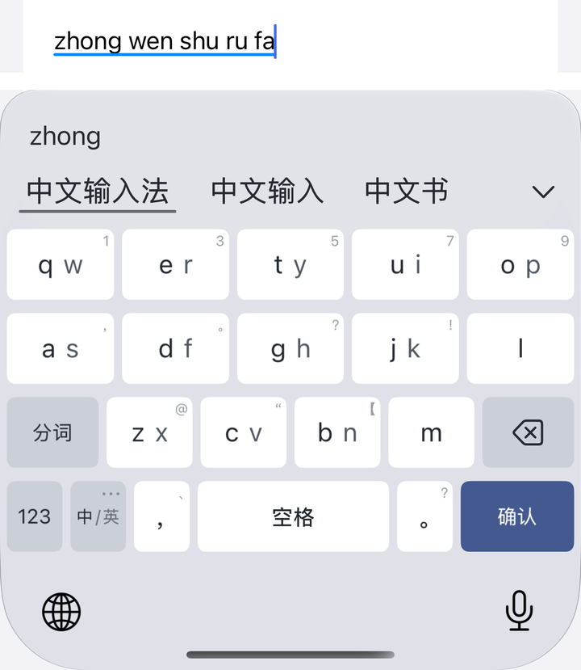
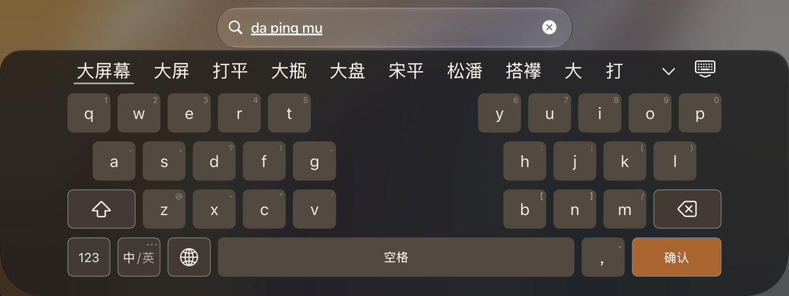
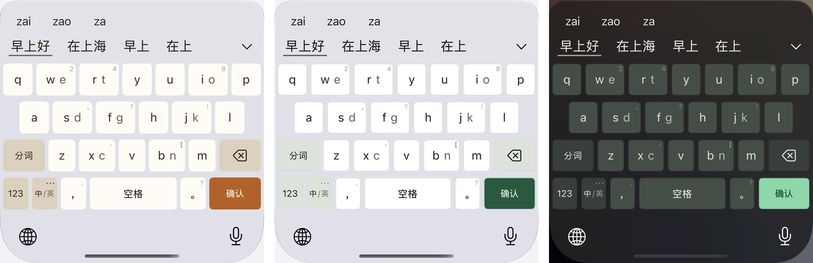

# Songyan (松烟)

[简体中文](README.zh-CN.md)

A keyboard for iPhone and iPad built on the [RIME](https://rime.im) input method engine. Design every key and every page yourself. Use any RIME input scheme directly on 9, 14, or 18 keys. Keyboard layout and appearance files work interchangeably with [Songyan for Android](https://github.com/Suzukaa-a/songyan-android).

## Install

1. Download the IPA from [Releases](https://github.com/Suzukaa-a/songyan-ios/releases) and install
   it with a tool that signs it under your own Apple ID, such as AltStore or SideStore. Or build it
   yourself (see below). iOS 17.0 or later. The keyboard and the app share their data through an App
   Group; Sideloadly with a free Apple ID has been reported to grant none, and then the keyboard
   cannot see what you set in the app.
2. Add Songyan under Settings → General → Keyboard → Keyboards. It types without Allow Full Access;
   turning it on adds key sounds, phrases and scripts that go online. Settings → Allow Full Access in
   the app lists what needs it.

## Highlights

### Design your own keyboard

  

- Customize any key: its label, subtitle, width, tap action, and long-press options.
- Add, delete, or move keys, or add an entire row of keys.
- Set where each row splits and how far apart the halves sit, independently for each keyboard layout.
- Create your own 123 and symbol pages, browse symbols by category, and pair them with each keyboard.
- Choose which buttons appear on the toolbar.
- Show double pinyin final hints on letter keys, and write hints yourself or import and export them.
- Export keyboard layouts as files to share, or import files from others; they work on Android too.

### Any input scheme on 9 keys

  
  

Songyan automatically generates 9, 14, and 18-key layouts from the input scheme you are already using, without needing extra schemes. Whether you use rime-ice, wanxiang, or a custom imported scheme, simply switch the keyboard layout and keep typing—with the same dictionary and learned words.

### iPad and large screens

  

When the keyboard width exceeds your set threshold, it splits into two halves for comfortable two-thumb typing. You can adjust the split threshold width, middle spacing, key area alignment, and side margins; iPhone also supports one-handed mode.

### Appearance

  

Use built-in appearances, or create your own with the [appearance editor](https://suzukaa-a.github.io/songyan-themes/) and import the file directly. You can also customize the candidate bar style and reading display position. Appearance files work on both iOS and Android.

### Add features to the keyboard

- **Scripts:** Paste a JavaScript snippet to add custom features, such as polishing or translating text with your own AI model. Preview the result before confirming replacement or insertion.

### What you type stays on your device

The input method engine runs locally on your device, and the keyboard itself does not connect to the internet on its own. Scripts can only reach websites they declare, which are clearly listed for your confirmation before you add them.

## All features

- **Input schemes:** Built-in Full Pinyin and Xiaohe Double Pinyin, plus any RIME scheme—Pinyin, Double Pinyin, Zhuyin, Cangjie, Quick, Cantonese, Japanese, and more. Add from the recommended list, or import from files or links. Nothing is downloaded until you confirm.
- **Keyboard layouts:** 26, 14, 18, and 9 keys, plus Zhuyin, Cangjie, Japanese Romaji, and Kana layouts.
- **Cursor:** Press and hold space, then slide left or right to move the cursor.
- **Phrases and symbol library:** Use them directly in the keyboard.
- **From RIME:** Simplified/Traditional conversion (including Taiwan and Hong Kong standards), fuzzy pinyin, typo correction, prediction, grammar models, Lua scripts, and `custom.yaml` configuration; back up and merge learned words.
- **Scripts:** As described above.
- Interface available in Simplified Chinese, Traditional Chinese, and Japanese.

## Privacy

Songyan collects no personal data and sends nothing to its developers or to anyone else. Songyan never
goes online on its own. The app connects to the internet only when you ask it to: downloading or
updating an input scheme, downloading a dictionary or model file, or adding a script from a link.
What you type and the words it learns stay on your device.

The scripts you add are the exception: when one runs, it sends the text it works on to the sites
it declares or the addresses you enter in its settings (plain http reaches only an address you
entered on this device or your local network). Those requests come from the keyboard, need Allow
Full Access, and do not pass through a Songyan server.

## Known issues

- **Extra 17 pt gap above the keyboard (iOS 26 and 27).** After switching apps with the keyboard
  up, or switching to Songyan from a system keyboard with a top bar, iOS can add a blank strip above
  third-party keyboards. Switch to the Emoji keyboard and back, or reopen the app. Reported to Apple
  ([forum](https://developer.apple.com/forums/thread/843093), FB24460699, FB25094825).

## Build from source

Open `Songyan.xcodeproj`, or run `make sim-stage` to build and install on a simulator without a
developer account. Prerequisites, gates and project rules are in [CONTRIBUTING.md](CONTRIBUTING.md),
the module map in [ARCHITECTURE.md](ARCHITECTURE.md), and simulator automation in
[DEBUG.md](DEBUG.md). Report security problems as described in [SECURITY.md](SECURITY.md).

## License

Copyright © 2026 Suzukaa-a. [GPL-3.0-only](LICENSE). Third-party components and their licenses are
listed in [Resources/Legal/ThirdPartyNotices.txt](Resources/Legal/ThirdPartyNotices.txt) and
[Resources/Legal/ThirdPartyNotices-iOS.txt](Resources/Legal/ThirdPartyNotices-iOS.txt).
