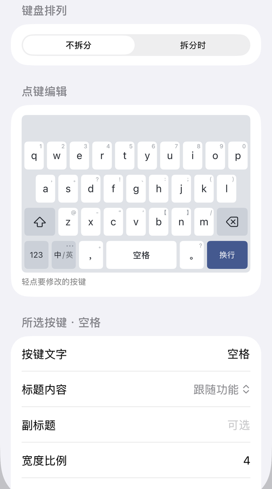
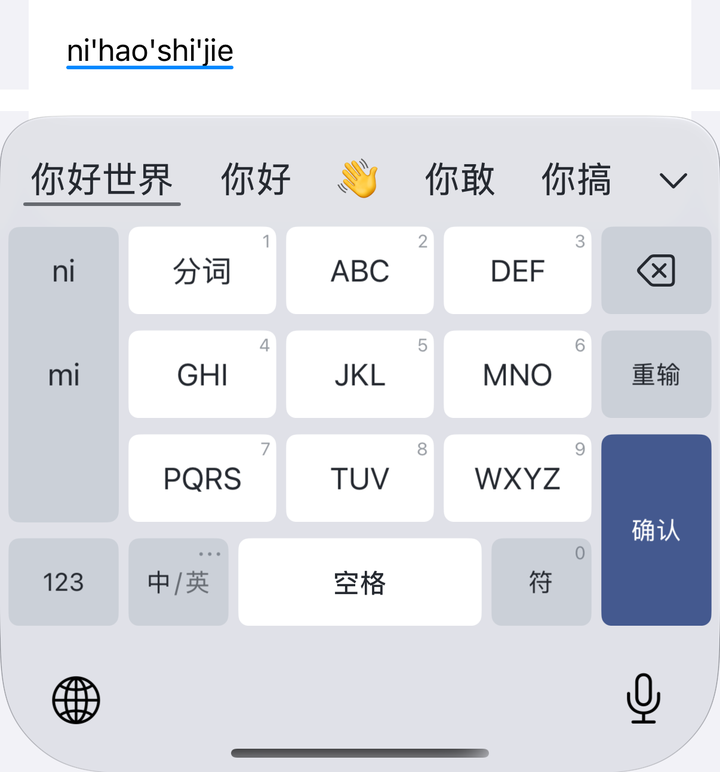
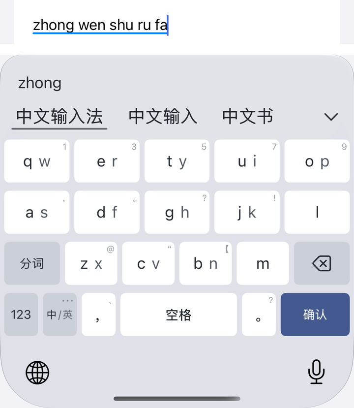
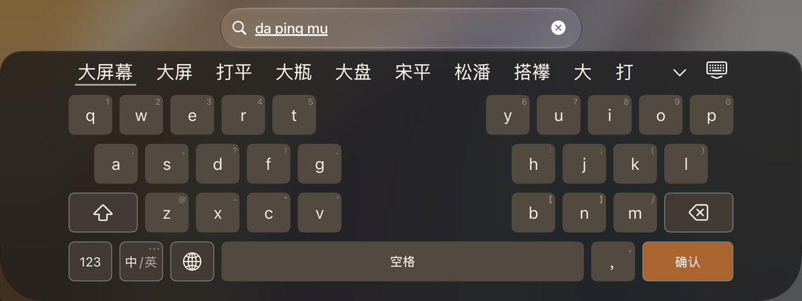
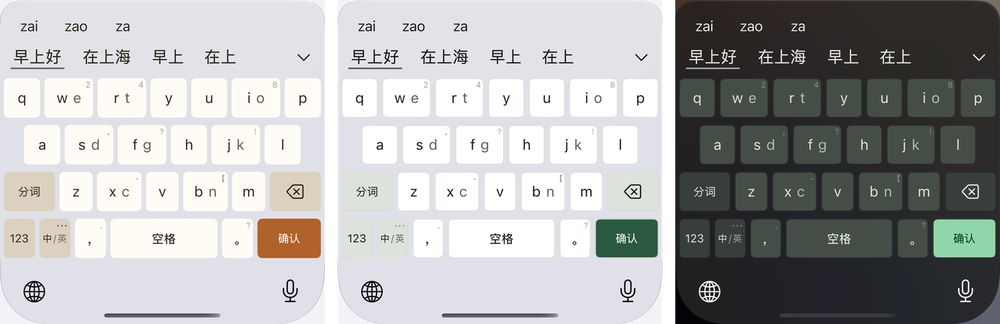

# 松烟（Songyan）

[English](README.md)

基于 [RIME 中州韵](https://rime.im) 引擎的 iPhone / iPad 输入法。键盘的每个键、每个页面都能自己设计。任何 RIME 输入方案都能直接使用九键、14 键与 18 键。键盘布局与外观文件与 [松烟 Android 版](https://github.com/Suzukaa-a/songyan-android) 通用。

## 安装

1. 从 [Releases](https://github.com/Suzukaa-a/songyan-ios/releases) 下载 IPA，用 AltStore、SideStore 这类能用你自己的 Apple ID 重新签名的工具安装；也可以自己构建（见下文）。需要 iOS 17.0 或更高版本。键盘和松烟 App 通过 App Group 共用数据；有报告称 Sideloadly 用免费 Apple ID 安装时不授予 App Group，这时键盘读不到你在 App 里的设置。
2. 在「设置 → 通用 → 键盘 → 键盘」中添加松烟。不开「允许完全访问」也能正常打字；开启后才有按键声音、常用语和联网的脚本，App 里「设置 → 允许完全访问」列出了哪些功能需要它。

## 特色

### 自己设计键盘

  

- 每个键都能改：主标题、副标题、宽度、点按动作与长按选项。
- 键可以添加、删除或移动位置，也能添加整行按键。
- 拆分时每一行从哪里分开、两边相隔多远，都可以按键盘布局分别设置。
- 123 与符号页面可以自己做，符号页能分类浏览，再给每个键盘搭配。
- 工具栏放置哪些按钮，都由你决定。
- 双拼方案可以在字母键上显示韵母提示，提示可以自己编写，也能导入或导出。
- 键盘布局可导出为文件分享，也可以导入他人制作的文件，并与 Android 版通用。

### 任何输入方案都能用九键

  
  

松烟按你正在用的输入方案自动生成九键、14 键和 18 键，不用另装方案。雾凇拼音、万象拼音或你自己导入的方案，换个布局就能接着打，词库和学到的词还是同一份。

### iPad 和大屏

  

键盘宽度超过设定值时拆成左右两半，两手各打一边。拆分的判定宽度、中间间距、键区位置和两侧留白都能调；iPhone 上也有单手模式。

### 外观

  

可以用内置外观，也可以用[网页外观编辑器](https://suzukaa-a.github.io/songyan-themes/)自己做，再导入文件。候选栏样式和读音的位置也能选。外观文件 iOS 和 Android 通用。

### 给键盘加功能

- **脚本**：粘贴一段 JS，就能给键盘加一个功能，比如用你自己的大模型润色或翻译。结果先预览，再替换或插入。

### 打字的内容不离开设备

引擎在键盘里、在你的设备上运行。脚本只能连它声明过的网站，添加前会列给你看。

## 全部功能

- **输入方案**：内置全拼与小鹤双拼，也能用任何 RIME 输入方案，拼音、双拼、注音、仓颉、速成、粤拼、日语等；可从推荐列表添加，也可从文件或链接导入。你确认后才会下载。
- **键盘布局**：提供 26 键、14 键、18 键、9 键，以及注音、仓颉、日语罗马字和假名键盘。
- **光标**：长按空格后左右滑动移动光标。
- **常用语与符号库**：直接在键盘中使用。
- **RIME 提供的功能**：简繁转换（也有台湾、香港用字）、模糊音、错键纠正、联想、语法模型、Lua 脚本与 `custom.yaml` 配置；学到的词可以备份和合并。
- **脚本**：如上文所述。
- 界面提供简体中文、繁体中文和日语。

## 隐私

松烟不收集任何个人数据，也不向开发者或任何人发送数据。松烟自己从不主动联网；只有你在 App 里操作时才会联网：下载或更新输入方案，下载词库、模型文件，或从链接添加脚本。你输入的内容和学到的词只留在你的设备上。

你添加的脚本是例外：运行时它会把要处理的文字发到它声明的网站，或你在它的设置里填的地址（明文 http 只能连你填的本机或局域网地址）。这些请求从键盘发出，需要打开「允许完全访问」，不经过松烟的服务器。

## 已知问题

- **键盘上方多出 17 pt 空白（iOS 26、27）**：键盘弹出时切换 App，或从带顶栏的系统键盘切到松烟后，iOS 可能在第三方键盘上方加一条空白。切到表情键盘再切回来，或重新打开当前 App 即可恢复。已反馈给 Apple（[论坛](https://developer.apple.com/forums/thread/843093)，FB24460699、FB25094825）。

## 从源码构建

打开 `Songyan.xcodeproj`，或者运行 `make sim-stage`，不需要开发者账号就能在模拟器上构建并安装。环境要求、检查命令和项目规则见 [CONTRIBUTING.md](CONTRIBUTING.md)，模块结构见 [ARCHITECTURE.md](ARCHITECTURE.md)，模拟器自动化见 [DEBUG.md](DEBUG.md)。安全问题请按 [SECURITY.md](SECURITY.md) 报告。

## 许可

Copyright © 2026 Suzukaa-a。采用 [GPL-3.0-only](LICENSE) 许可。第三方组件及其许可见 [Resources/Legal/ThirdPartyNotices.txt](Resources/Legal/ThirdPartyNotices.txt) 与 [Resources/Legal/ThirdPartyNotices-iOS.txt](Resources/Legal/ThirdPartyNotices-iOS.txt)。
